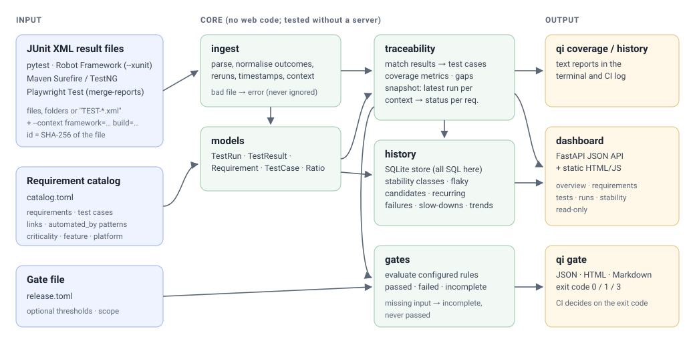
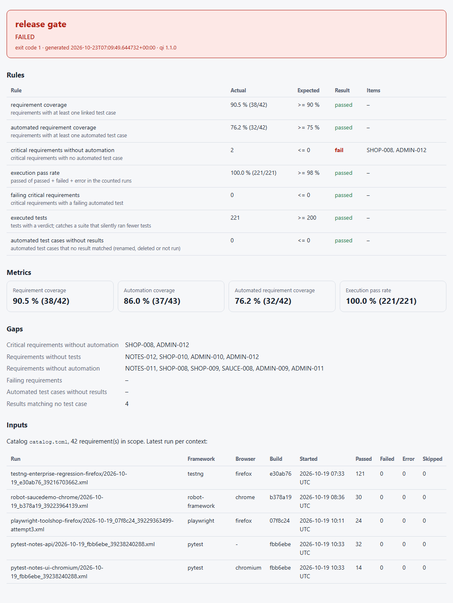

# Automation Coverage & Quality Intelligence

[](https://github.com/niranjankagri/automation-coverage-quality-intelligence/actions/workflows/ci.yml)

A quality engineering platform that sits **on top of** existing test automation. It imports the
JUnit XML results that Selenium/TestNG, Playwright, pytest and Robot Framework suites already
produce, links them to requirements, and answers the questions a release decision needs:

- Which requirements are tested at all, and which of those tests are automated?
- Which **critical** requirements have no automated test?
- What failed in the latest runs, and which requirements does that put at risk?
- Which tests are **flaky candidates**, which failures recur, which tests got slower?
- Does this build meet the release criteria? (`qi gate` exits 0, 1 or 3 in CI)

**Business value:** coverage, pass rate and stability stop being opinions in a release meeting.
Every number is a documented formula with its counts (`90.5 % (38/42)`), every gap has a name
(`SHOP-008: card payment, planned, critical`), and the pipeline blocks a release on rules the team
wrote down, while broken or missing test results can never slip through as a pass.

It runs no tests and replaces no framework; it complements the automation projects in my
[portfolio](https://niranjankagri.github.io).


## Try it (about two minutes)

Python 3.12 or newer.

```bash
git clone https://github.com/niranjankagri/automation-coverage-quality-intelligence.git
cd automation-coverage-quality-intelligence
python -m venv .venv
.venv/Scripts/activate            # Windows cmd: .venv\Scripts\activate · Linux/macOS: source .venv/bin/activate
pip install -e .
python tools/demo.py              # ten documented steps; each checks its exit code
qi dashboard --catalog samples/catalog.toml --database demo-output/quality.db   # http://127.0.0.1:8000
```

`tools/demo.py` ends with `10 of 10 steps behaved as documented`; CI runs it from a clean
checkout on every push (job *Demonstration from a clean checkout*).

## What it does

| Area | Commands | What you get | Docs |
|---|---|---|---|
| Ingestion | `qi inspect` | JUnit XML from files, folders or quoted patterns; outcomes, reruns, nested suites, explicit test ids, run context; every unreadable file reported | [ingestion](docs/ingestion.md) |
| Traceability | `qi coverage` | requirement coverage, automation coverage, automated requirement coverage; gaps; breakdowns by feature, criticality, test type, platform; execution status per requirement | [traceability](docs/traceability.md), [metrics](docs/metrics.md) |
| History | `qi history import / report / compare` | SQLite history; stability classes with evidence (flaky candidates, consistent and new failures); recurring failures; duration regressions; trends | [history](docs/history.md) |
| Quality gates | `qi gate` | configurable rules; passed / failed / incomplete as exit codes 0 / 1 / 3; JSON, HTML and Markdown reports | [quality gates](docs/quality-gates.md) |
| Dashboard | `qi dashboard` | read-only web UI and JSON API (`/docs`) over the same numbers | [dashboard](docs/dashboard.md), [OpenAPI](docs/api/openapi.json) |

## The sample data is real

The 43 result files in [`samples/results`](samples/README.md) come from GitHub Actions runs of my
public test repositories (pytest, Robot Framework, Maven Surefire/TestNG with Selenium, Playwright
Test), sanitised before committing. They include real failures: a Selenium timeout in the
enterprise nightly of 13 Oct, and a Playwright run on 19 Oct that needed three attempts while the
public demo site was down. Only the requirement catalog is synthetic
([`samples/catalog.toml`](samples/catalog.toml)): 42 requirements for the four demo
applications those repositories test, with deliberate gaps.

What the platform finds in it (each number checked by a test):

| Finding | Value |
|---|---|
| Requirement coverage / automation coverage / automated requirement coverage | 90.5 % (38/42) · 86.0 % (37/43) · 76.2 % (32/42) |
| Critical requirements without automation | `SHOP-008`, `ADMIN-012` → the sample release gate **fails** |
| Execution pass rate of the latest run per context | 100.0 % (221/221) → the nightly gate **passes** |
| Flaky candidates (passed and failed on the same build) | 4: the 13 Oct Selenium timeout and three Playwright tests hit by the site outage |
| Duration regressions confirmed over two runs | 2 (19 single-run spikes in a parallel suite were correctly ignored) |

## How it works



One Python package with one sub-package per responsibility; business logic never imports the
dashboard (a test parses every import to enforce it). Details: [architecture](docs/architecture.md),
[package layers](docs/images/architecture.svg), [decision records](docs/adr/).

```
src/qualityintel/
  models/         typed, immutable data model; Ratio keeps numerator and denominator
  ingest/         JUnit XML and catalog readers, batch import, errors that name the file
  traceability/   result matching, coverage metrics, gaps, execution status
  history/        SQLite store; stability, recurring failures, durations, trends
  gates/          gate file, rule evaluation, passed / failed / incomplete
  reporting/      text, JSON, HTML and Markdown renderers (no calculations)
  workspace.py    view models behind every dashboard page
  dashboard/      FastAPI JSON API + static HTML/JS front end
  cli.py          the qi command and its exit codes
```

## Quality gates in a pipeline

```yaml
- run: pytest --junitxml=reports/junit.xml
  continue-on-error: true
- if: always()                      # also when the tests crashed and wrote nothing
  run: >-
    qi gate --catalog quality/catalog.toml --config quality/release.toml reports/
    --context build=${{ github.sha }} --json reports/gate.json --html reports/gate.html
    --summary "$GITHUB_STEP_SUMMARY"
```

| Exit code | Meaning |
|---|---|
| 0 | every configured rule passed |
| 1 | a rule failed; the report names the requirements or tests |
| 2 | invalid gate file or usage (a misspelt threshold is an error, not a silently skipped rule) |
| 3 | input missing, unreadable or empty: **never** treated as a pass |
| 4 | internal error; a crash never looks like a gate decision |



## Evidence: the plan's acceptance criteria

This repository gates its own release on them: [`quality/catalog.toml`](quality/catalog.toml)
lists the ten acceptance criteria and five implementation rules of the project plan, linked to
the tests below, and CI job *Self gate* runs `qi gate` on this repository's own JUnit results
(15/15 requirements automated, all tests passing).

| # | Criterion | Proven by |
|---|---|---|
| 1 | Results from at least two distinct automation projects import | 4 producers, 43 real files: `tests/integration/test_real_samples.py` |
| 2 | Normalised without losing essential information | counts equal each producer's own totals, context and failures survive (same file) |
| 3 | Requirements map to test cases | `tests/unit/traceability/test_matching.py`; every sample pattern matches a real test |
| 4 | Gaps and uncovered critical requirements are found | `tests/unit/traceability/test_coverage.py` (hand-calculated), sample hand counts |
| 5 | Dashboard metrics match independent calculations | a second, standard-library-only implementation in `tests/integration/test_sample_traceability.py`; API and browser tests show the same numbers |
| 6 | Historical trends can be inspected | `tests/unit/history/`, `qi history report`, the Stability page (browser test) |
| 7 | Gates pass or fail a pipeline | `tests/unit/test_cli_gate.py`; CI job *Quality gates* asserts exit codes 0, 1, 1 and 3 |
| 8 | Tests validate calculations, ingestion and gates | 503 unit and integration tests + 13 browser tests, 98 % branch coverage |
| 9 | A clean checkout reproduces the demonstration | `tests/integration/test_demo.py`; CI job *Demonstration from a clean checkout* |
| 10 | No sensitive data in docs and reports | `tests/integration/test_repository_hygiene.py` scans every tracked file (it found and fixed a local path in two sample files) |

## How this repository is checked

| Check | Tool | CI job |
|---|---|---|
| Lint incl. a docstring on every public item, formatting | ruff | Lint, format, types |
| Types, package and tests | mypy `--strict` | Lint, format, types |
| 503 unit and integration tests, branch coverage >= 90 % (98 %), warnings are errors | pytest | Tests (Python 3.12, 3.13) |
| 13 dashboard tests in a real browser, incl. 390 px phone width | Playwright, Chromium | Dashboard in Chromium |
| Sample gates: passed, failed, failed on a real attempt, incomplete | `qi gate` | Quality gates (sample data) |
| The plan's acceptance criteria | `qi gate` on this repo's own results | Self gate |
| Reproducible demonstration | `tools/demo.py` | Demonstration from a clean checkout |

Development setup: `pip install -e ".[dev,e2e]"`, `playwright install chromium`, then
`ruff check . && ruff format --check . && mypy && pytest --cov && pytest -m e2e`.

## Documentation

[Architecture](docs/architecture.md) · [Metric definitions](docs/metrics.md) ·
[Ingestion](docs/ingestion.md) · [Traceability](docs/traceability.md) · [History](docs/history.md) ·
[Quality gates](docs/quality-gates.md) · [Dashboard and API](docs/dashboard.md) ·
[Limitations and future work](docs/limitations.md) · [Decision records](docs/adr/) ·
[Sample data](samples/README.md) · [Changelog](CHANGELOG.md)

## License

[MIT](LICENSE). Code, documentation and the requirement catalog are my own work; the sample
results are sanitised CI output of my own public repositories.
