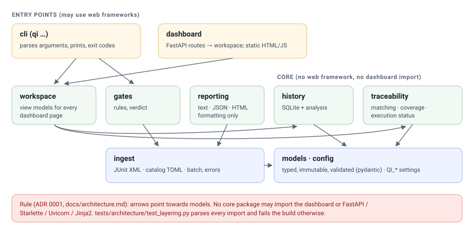

# Architecture

Status: release 1.0.0, all eight milestones done. Each section names the milestone that built it.

## Purpose

Existing automation projects (Selenium, Playwright, Appium, Robot Framework, API suites) each
produce their own results. None of them can answer the release questions on its own:

- Which requirements have tests at all, and which of those tests are automated?
- Which critical requirements have no coverage?
- Which failures are new, which recur, and which tests look flaky?
- Do this build's results meet the release criteria?

This project answers them by importing the results the frameworks already produce. It does
not run tests itself and does not replace any framework.

## Data flow

Result files and the catalog are read by `ingest` into the typed `models`; `traceability`
matches results to test cases and computes coverage and execution status; `history` stores runs
and analyses them over time; `gates` turn the numbers into passed / failed / incomplete. The
command line and the dashboard only present what the core computed.

## Layers and the dependency rule

| Package | Job | Milestone |
|---|---|---|
| `qualityintel.models` | Typed data model: requirements, test cases, mappings, results | 2 |
| `qualityintel.ingest` | Reads result files into the model: JUnit XML, mochawesome, Allure | 3 |
| `qualityintel.traceability` | Result matching, coverage metrics, gaps, execution status | 4 |
| `qualityintel.reporting` | Text/JSON/HTML renderers; formatting only, no calculations | 4, 7 |
| `qualityintel.dashboard` | Web view over the other packages | 5 |
| `qualityintel.history` | SQLite store (all SQL lives here); stability classes, recurring failures, durations, trends | 6 |
| `qualityintel.gates` | Release criteria, JSON/HTML reports, pipeline exit status | 7 |
| `qualityintel.config` | Settings from `QI_*` environment variables | 1 |
| `qualityintel.cli` | The `qi` command | 1 |

**Rule:** dependencies point towards `models`. No core package imports `dashboard` or a web
framework; only `dashboard` and `cli` may. `tests/architecture/test_layering.py` checks this on
every CI run by parsing the imports of each file, so a violation fails the build instead of
waiting for a code review to spot it.

Why: every number on the dashboard must come from logic that is tested without a browser or a
server. The dashboard only formats and filters.

## Key design decisions

The full reasoning is in [docs/adr](adr/). Short form:

1. **One Python package, not services** ([ADR 0001](adr/0001-modular-monolith.md)). The workload
   is a few thousand results per run; separate services would add deployment work and no benefit.
2. **JUnit XML is the common input** ([ADR 0002](adr/0002-junit-xml-first.md)). Every framework in
   scope can write it. Adapters are added only for frameworks whose native output needs conversion:
   mochawesome (Cypress) and Allure results ([ADR 0005](adr/0005-format-adapters.md)).
3. **SQLite for history** ([ADR 0003](adr/0003-sqlite-first.md)). One file, no server, enough for
   the demonstration. PostgreSQL only when a measured need appears.
4. **Coverage metrics are separate numbers** ([ADR 0004](adr/0004-separate-metrics.md)). Requirement
   coverage, automation coverage and pass rate answer different questions and are never merged
   into one "quality score".

## Exit codes

The `qi` command is meant to run inside CI pipelines, so its exit codes are a contract:

| Code | Meaning | Since |
|---|---|---|
| 0 | Success | Milestone 1 |
| 1 | A configured quality gate failed (`qi gate`) | Milestone 7 |
| 2 | Wrong usage or invalid configuration | Milestone 1 |
| 3 | Input missing or invalid (result files, catalog); nothing was evaluated | Milestone 3 |
| 4 | Internal error (a crash), never confused with a gate decision | Milestone 7 |

A missing, empty or unreadable result file always gives exit code 3, never 0, so a broken
pipeline step cannot turn into a green quality gate.

## Quality checks on this repository

| Check | Tool | Where |
|---|---|---|
| Lint (incl. docstrings on every public item) | ruff | CI `checks` job |
| Formatting | ruff format | CI `checks` job |
| Types | mypy `--strict`, package and tests | CI `checks` job |
| Tests + branch coverage ≥ 90 % | pytest, pytest-cov | CI `tests` job, Python 3.12 and 3.13 |
| Layering rule | `tests/architecture` | CI `tests` job |
