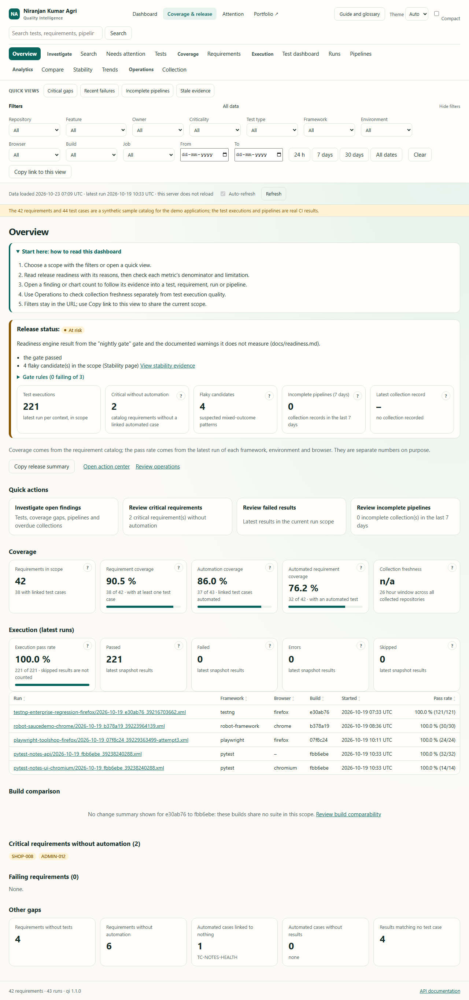
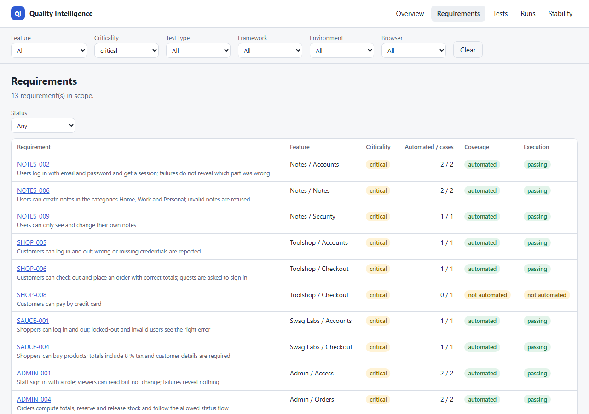
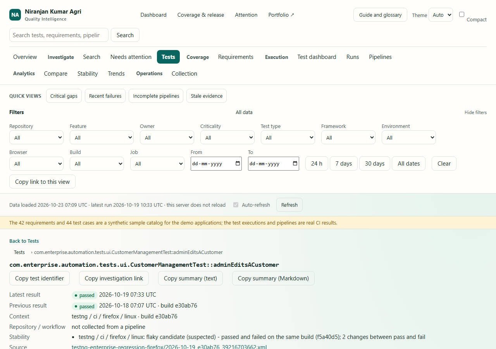
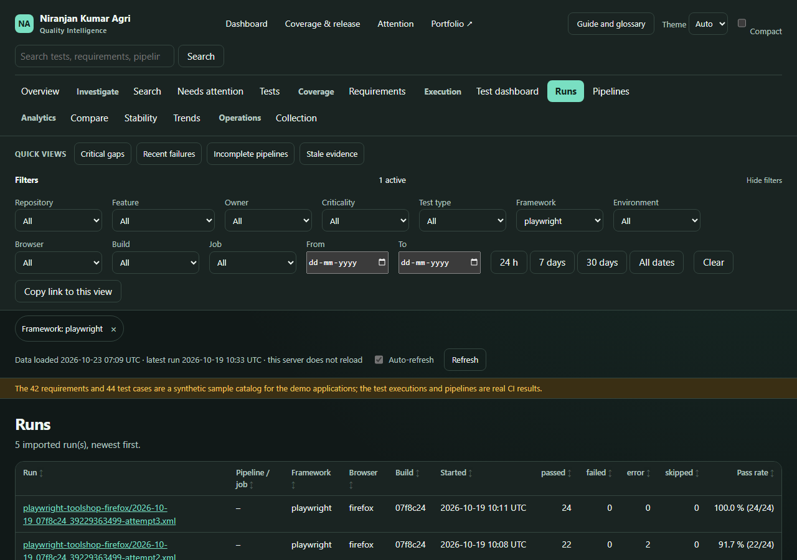
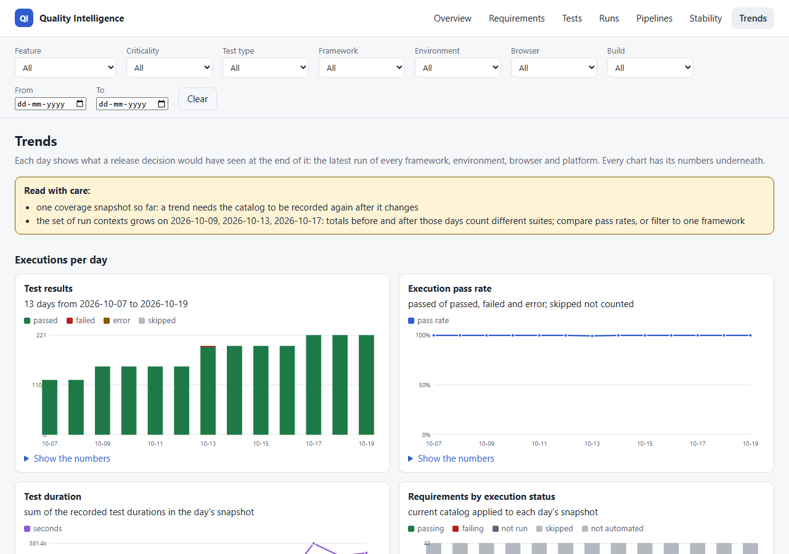
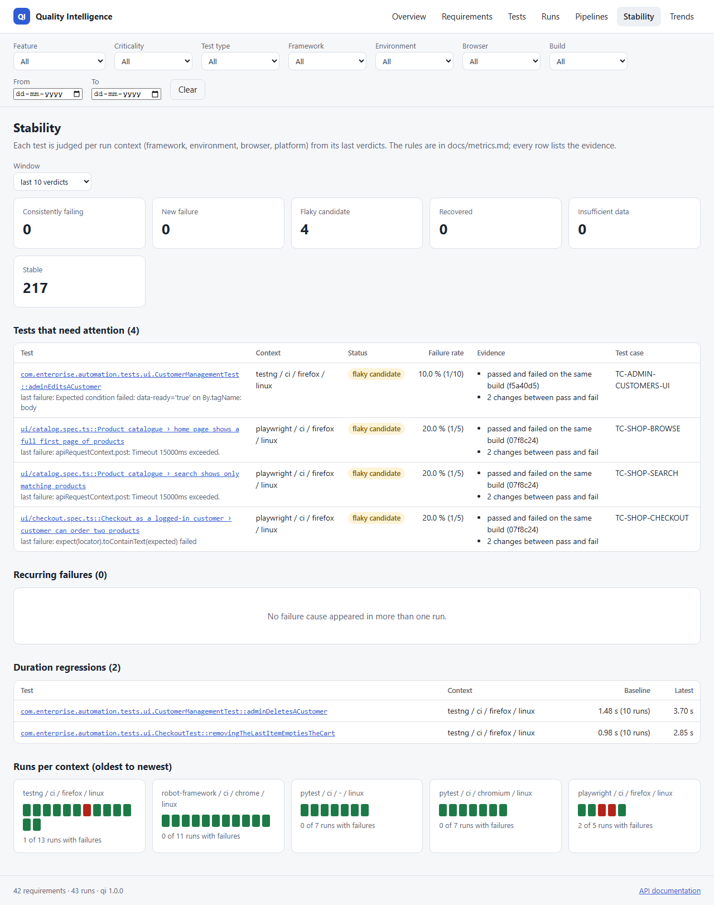
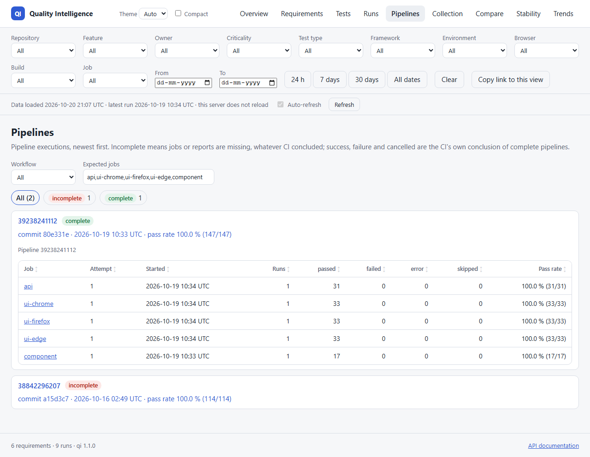

# Dashboard

A read-only web view over a requirement catalog and imported results. It shows the same numbers
as `qi coverage`: both read the core packages, and the dashboard calculates nothing itself
([architecture rule](architecture.md#layers-and-the-dependency-rule)).

```bash
qi dashboard --catalog samples/catalog.toml samples/results
# qi: dashboard on http://127.0.0.1:8000  (42 requirements, 43 runs)
qi dashboard --catalog samples/catalog.toml --database .qi/quality.db   # runs from the history
```

`--host` / `--port` (or `QI_DASHBOARD_HOST` / `QI_DASHBOARD_PORT`) change the address.

**Fresh data without a restart.** The server watches its sources (the catalog and the files it
includes, the history database, result files) and rebuilds the data when one of them changes,
every `--refresh` seconds (or `QI_REFRESH_SECONDS`; default 30, 0 = off). A rebuild is a complete
new snapshot swapped in at once, so a page never shows half-updated numbers; one rebuild runs at
a time. If a rebuild fails (database locked by a running import, corrupted file, broken catalog)
the last good data stays, and the page says so: "The last refresh failed ...; the figures shown
are from ...".

The bar under the filters shows when the data was loaded, the latest run, the last collection
and incomplete collections of the last 7 days ([collection.md](collection.md)). The page asks
`/api/status` at the server's interval and re-renders the current view when the data changed;
the address and every filter stay as they are. *Auto-refresh* switches that off (remembered in
the browser); *Refresh* checks at once (the server accepts one forced check every 5 seconds).

**Login:** on 127.0.0.1 (the default) no login is needed. Any other address is refused unless
`QI_DASHBOARD_PASSWORD` (12+ characters; user `QI_DASHBOARD_USER`, default `qi`) is set; then
every page and API call needs HTTP basic authentication. Put TLS in front when others connect
([security.md](security.md#running-the-dashboard-for-a-team)).

## Views

| View | Shows | Drill-down |
|---|---|---|
| Overview | **release status** (ready / at risk / blocked / unknown, with every reason and the gate's rules, [readiness.md](readiness.md)), test executions, critical requirements without automation, flaky candidates, incomplete pipelines, latest collection; requirements in scope; requirement coverage, automation coverage, automated requirement coverage; execution pass rate and pass / fail / error / skip counts of the snapshot; snapshot runs; critical requirements without automation; failing requirements; other gaps | every card opens the list behind it (e.g. requirement coverage -> requirements without tests) |
| Requirements | id, title, feature, criticality, automated / linked test cases, coverage status, execution status; status filter | requirement -> its test cases and their latest executions |
| Tests | every executed test with run, pass, fail, error, skip counts and last failure; search; latest-outcome filter | test -> investigation page: latest result and context, source run, pipeline and job with a link to the CI run, linked requirements and test cases, pass/fail pattern, duration chart with its numbers, latest failure and stack trace (shown as text, never as HTML), every execution; copy the test identifier or the page link |
| Compare | two builds side by side (runs, pass rate, counts, coverage snapshot) and the changes where both ran the same suite: newly failing, recovered, still failing, new, removed, slower, newly flaky; change-type chips; suites that ran in one build only listed separately ([history.md](history.md#comparing-builds)) | test -> its history |
| Runs | every imported run with pipeline / job, context, counts and pass rate | run -> all results, failures first |
| Pipelines | pipeline executions newest first, collected ones included even when they uploaded nothing; per pipeline: status (incomplete before the CI conclusion success / failure / cancelled), repository, workflow, run number, branch, commit, links to the exact GitHub run and commit, recorded problems, jobs with start time, attempt and counts, attempts of re-runs side by side; status chips and a workflow filter (both in the address); expected jobs ([pipelines.md](pipelines.md)) | job -> its run; run and commit -> GitHub |
| Collection | per repository: last collection, fresh or overdue against `QI_COLLECTION_HOURS` (default 26 h), pipelines, complete, incomplete, results and CI conclusions of the last 7 days, every missing artifact and ingestion problem, link to the collection workflow (`QI_COLLECTION_URL`) ([collection.md](collection.md)) | repository -> its pipelines |
| Trends | daily snapshots (results, pass rate, test duration, requirements by status), days that are not comparable (new suites, carried-over runs), duration per run for each context, coverage snapshots; every chart with its numbers in a table | run context charts list each run with its build |
| Stability | class counts; tests needing attention with evidence; recurring failures; duration regressions; runs per context | test -> history; run strip -> run ([history.md](history.md)) |

Filters (repository, feature, criticality, test type, framework, environment, browser, build, pipeline job, from/to date) apply to every view
and are kept in the address, so a filtered view can be bookmarked or shared. The drop-down values
come from the data (`/api/facets`), never from a fixed list.

Coverage and pass rate are separate cards on purpose ([ADR 0004](adr/0004-separate-metrics.md)).

**Accessibility and preferences:** every page is checked with axe-core against the WCAG 2.2 A/AA
rules it covers, in light and dark themes (`tests/e2e/test_accessibility.py`; automated checks find
a defined set of problems and do not replace a screen-reader review). The theme (Auto, Light,
Dark) and *Compact* tables are chosen in the header and remembered in the browser; animations
are off when the system asks for reduced motion; moving to another page puts the focus on its
heading; no page scrolls sideways at 390, 768 or 1280 px. The browser tests run in Chromium,
Firefox and WebKit (`QI_E2E_BROWSER`; in WebKit the skip-link test is skipped, because WebKit
moves Tab between form controls only, like Safari by default).

**Filter bar:** quick ranges (24 h, 7 days, 30 days, all dates) set *From*; each active filter is
a chip under the bar with a remove button; *Copy link to this view* copies the address, which
holds every filter (a shareable preset); *Clear* removes them all.

**Tables:** every column sorts (button in the header; `aria-sort` tells screen readers); tables
with 6 or more rows get a row filter, *Download CSV* (the filtered and sorted rows and visible
columns; cells a spreadsheet would run as formulas are made inert) and a column chooser; long
tables show 50 rows per page. Sorting and filtering only reorder what the API returned.

**Requirements:** a matrix by criticality and by feature (coverage status, execution status,
stale evidence; from `/api/requirements/matrix`), each coverage count a link to those
requirements; *Uncovered critical requirements* as a one-click filter; per requirement its latest
execution and a *stale* badge when that is older than 14 days.

**Stability:** flaky candidates are labelled *suspected*; each row shows failure rate, last
failure, the builds with mixed results, the evidence, and links to the last failing and the last
passing run.

**Charts:** on the Trends page each day's bar is a link (reachable with Tab, its numbers as its
name) to the runs of that day; every chart keeps its table of numbers.

## Screenshots (sample data)

| | |
|---|---|
|  |  |
|  |  |
|  |  |
|  | |

Made by `python tools/screenshots.py`; CI takes the same screenshots on every run (artifact
`dashboard-e2e`).

## JSON API

Interactive documentation: `/docs` (generated from the routes, so it cannot drift).

| Route | Answer |
|---|---|
| `GET /api/health` | status, version, number of requirements and runs |
| `GET /api/status?check=` | data version, when it was loaded, latest run, refresh interval, last check and error, stale flag, collection freshness; `check=true` looks for new data first |
| `GET /api/facets` | filter values present in the data |
| `GET /api/readiness` | release status of the scope with reasons, gate rules and headline numbers |
| `GET /api/summary` | coverage metrics, gaps, snapshot runs, outcome counts, pass rate |
| `GET /api/requirements/matrix` | requirements by criticality and feature: coverage, execution and stale counts |
| `GET /api/requirements?status=` | requirement rows; `status` = a coverage or execution status |
| `GET /api/requirements/{id}` | one requirement, its test cases and their latest executions |
| `GET /api/tests?outcome=` | every executed test with counts |
| `GET /api/tests/history?key=` | all executions of one test, newest first (key in the query: it contains `/` and `::`) |
| `GET /api/runs` | runs, newest first |
| `GET /api/runs/{run_id}` | one run, failures first |
| `GET /api/pipelines?jobs=&status=&workflow=` | pipeline executions with status, CI conclusion, GitHub links, attempts, jobs, missing jobs and problems; status counts and workflows for the filters |
| `GET /api/collection` | collection health per repository |
| `GET /api/trends` | daily snapshots, run series per context, coverage snapshots, notes on what is not comparable |
| `GET /api/builds` | builds in scope in the order they first ran |
| `GET /api/compare?base=&head=` | build comparison (422 for the same build twice, 404 for an unknown build) |
| `GET /api/stability?window=&include_stable=` | stability classes with evidence, recurring failures, duration regressions, trends per context |

Filter parameters are repeatable: `?criticality=critical&criticality=high&browser=firefox`; dates are
`since=2026-10-13&until=2026-10-15` (inclusive, UTC; `since` after `until` is a 422).
Unknown ids give **404**; a value that can never match (`criticality=urgent`, `outcome=green`)
gives **422** with the allowed values; a valid value nobody used (`browser=safari`) gives an empty
scope with `n/a` metrics.

## Front end

Plain HTML, CSS and JavaScript served by the package (no build step, no CDN). All text is
inserted with `textContent`, because real test names contain quotes, brackets and `<`. Pages are
served with a strict Content-Security-Policy (`default-src 'self'`, no inline script or style),
`X-Content-Type-Options: nosniff` and `Referrer-Policy: no-referrer`. Light and dark themes
follow the operating system.

States: a loading line while data is fetched; an empty-state text when a list has no rows; an
error box with the API's message and a Retry button when a request fails; a message for unknown
pages and ids.

## How it is tested

| Level | What | Where |
|---|---|---|
| View models | every number, order and filter of every view, without a server | `tests/unit/test_workspace.py` |
| API | routes, filters, 404 / 422, security headers, OpenAPI route list | `tests/unit/dashboard/test_api.py` (FastAPI TestClient) |
| Browser | overview numbers, drill-down, filters in the URL, detail pages, real failure in the history, empty state, API error + retry, unknown pages, phone and tablet width without sideways scrolling, skip link; any JavaScript console error fails the test | `tests/e2e/test_dashboard.py` (Playwright, Chromium), CI job `dashboard` |

Found by the browser tests while building it: the section links in the header dropped the active
filters (fixed: they are rebuilt with the filters on every view change), and a broken string in
the script (caught by the console-error check).

## Charts

Charts are inline SVG drawn by the page itself (no chart library, nothing from a CDN, allowed by
the strict CSP). Each chart has a text summary for screen readers and a "Show the numbers" table
with exactly the values it draws; the browser tests compare that table with the API.
