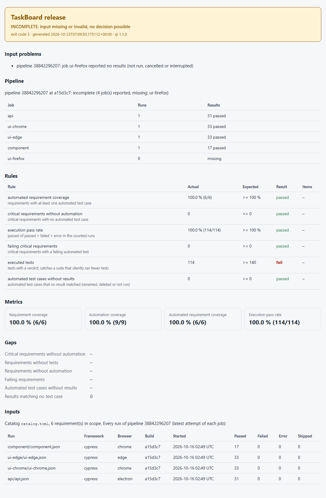

# Pipeline executions

A CI pipeline execution (a GitHub Actions run, a GitLab pipeline, a Jenkins build) usually has
several test jobs: API tests, UI tests per browser, component tests. Each job writes its own
result files. Without grouping, a release gate sees "some result files" and cannot tell that a
job is missing. If the Firefox job was cancelled, the gate decides on the jobs that did report,
and everything that reported passed.

`qi` groups the jobs of one execution and refuses to decide on an incomplete one
([ADR 0006](adr/0006-pipeline-executions.md)).

## Importing a pipeline

Instead of plain result paths, name the execution and give each job's results:

```bash
qi gate --catalog catalog.toml --config release.toml \
  --pipeline 39238241112 --attempt 1 --branch main --commit 80e331e \
  --job api=artifacts/report-api \
  --job ui-chrome=artifacts/report-ui-chrome \
  --job ui-firefox=artifacts/report-ui-firefox

qi history import --pipeline 39238241112 --commit 80e331e --job api=artifacts/report-api ...
```

| Option | Meaning |
|---|---|
| `--pipeline ID` | the execution, e.g. `${{ github.run_id }}`, `$CI_PIPELINE_ID`, `$BUILD_TAG` |
| `--job NAME=PATH` | results of one job: file, folder or quoted pattern, any supported format; repeat for every job, and for several paths of one job |
| `--attempt N` | re-run number of the jobs given (`${{ github.run_attempt }}`); default 1 |
| `--branch`, `--commit` | where and what the pipeline tested; recorded on every run |

With `--pipeline`, every input must be a `--job` (plain paths are refused, because their job
would be unknown); `--job`, `--attempt`, `--branch` and `--commit` without `--pipeline` are
usage errors (exit 2). Each run's source is prefixed with its job (`ui-chrome/index.html`).

In GitHub Actions the artifacts of all jobs land in one folder per artifact, so a final job can
download them and name each folder:

```yaml
- uses: actions/download-artifact@v7
  with: { path: artifacts }          # one sub-folder per artifact
- if: always()
  run: >-
    qi gate --catalog quality/catalog.toml --config quality/release.toml
    --pipeline ${{ github.run_id }} --attempt ${{ github.run_attempt }}
    --branch ${{ github.ref_name }} --commit ${{ github.sha }}
    --job api=artifacts/report-api --job ui-chrome=artifacts/report-ui-chrome
```

This repository's own self gate works this way (`.github/workflows/ci.yml`, job *Self gate*).

## When an execution is complete

| Rule | Why |
|---|---|
| a job's **highest attempt** counts; earlier attempts are kept in history but replaced | a re-run job counts once, with its latest result |
| every **expected job** reported runs | a cancelled, skipped or crashed job leaves no report: "not run, cancelled or interrupted" |
| every expected job reported **at least one test result** | an empty report means the suite never ran |
| all jobs agree on **branch and commit** | artifacts of two executions mixed under one id are caught |

Expected jobs come from the gate file:

```toml
[pipeline]
jobs = ["api", "ui-chrome", "ui-firefox", "ui-edge", "component"]
```

Without a `[pipeline]` section, the jobs named with `--job` are the expected ones (a named job
whose folder is missing still makes the execution incomplete). A gate file with `[pipeline]`
refuses plain result paths: they cannot show that every job reported.

An incomplete execution makes the gate **incomplete (exit 3)**, even when every rule passes on
the results that exist. A complete execution with a failed test is a normal **failed** gate
(exit 1): failures are a decision, missing jobs are not. Extra jobs that are not expected are
listed in the report but do not block.

**Which runs count:** in a pipeline gate, every run of the execution counts (all files of every
job's highest attempt). Outside a pipeline the snapshot is the latest run per context; there,
the pipeline job is part of the context, so two jobs that run in the same browser (component
tests and UI tests, both in Chrome) never replace each other.

## Reports

The gate's JSON report has a `pipeline` key (`null` without one): `id`, `state` (`complete` /
`incomplete`), `branch`, `commit`, `missing_jobs`, and per job `name`, `attempt`, `expected`,
`runs`, `superseded_runs` and `outcomes`. Text, Markdown and HTML show the same as a job table
([quality-gates.md](quality-gates.md)).



## History

`qi history import --pipeline ...` stores the job with every run (history schema 3; older
databases gain the columns when opened). **One import per job attempt:** importing the same
files again is harmless (already stored), but other files for a job attempt that is already
stored are refused (exit 3, nothing stored), because that would mix two executions of the job.
A re-run of a job is imported with the next `--attempt`.

## Dashboard

The **Pipelines** page lists executions newest first with their jobs, results and state. A
history database does not know which jobs a pipeline should have. Enter them under *Expected
jobs* (kept in the address) to find executions with missing jobs. Without them, only consistency is
checked. Run filters (browser, framework, dates ...) choose which executions are listed but
never remove jobs from one. The Runs page shows each run's pipeline and job.


## Real example

`samples/pipelines/cypress-taskboard` holds every report of two runs of the TaskBoard Cypress
pipeline ([samples/README.md](../samples/README.md)): one complete (147 tests passed in five
jobs) and one cancelled by a newer push, where the Firefox job uploaded nothing.
`tests/integration/test_pipeline_samples.py` checks that the first passes the sample gate, the
second is incomplete although all 114 existing results passed, and that a gate without pipeline
grouping would have passed it.

## Limits

- `qi` judges a job by its reports, not by the CI system's job status. A job that wrote a
  complete report and was cancelled afterwards (as in the sample) counts as reported; a job
  that crashed half-way through writing its report is caught only if the report is unreadable
  or empty.
- Run ids are content hashes: the same file imported under two pipelines is stored once, with
  the first pipeline.
- The dashboard needs the expected jobs typed in (or taken from the URL); it does not read gate
  files.
